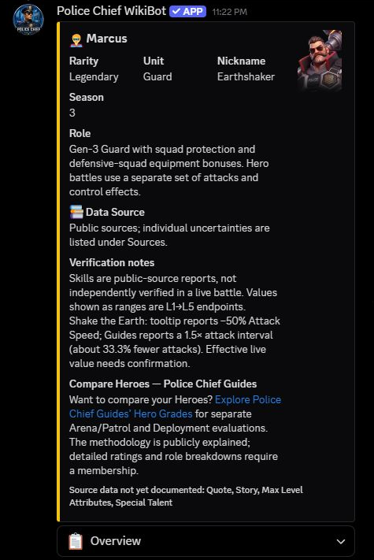
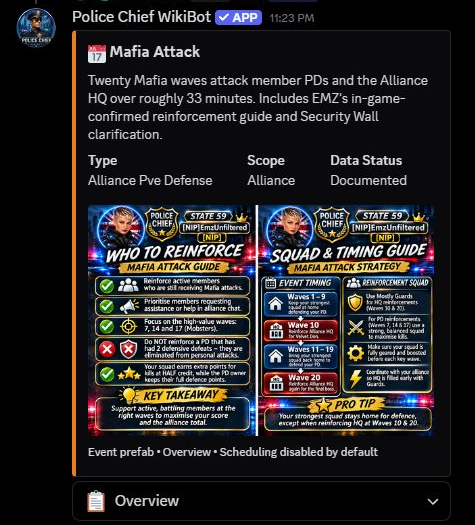
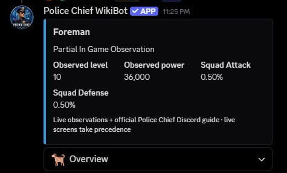
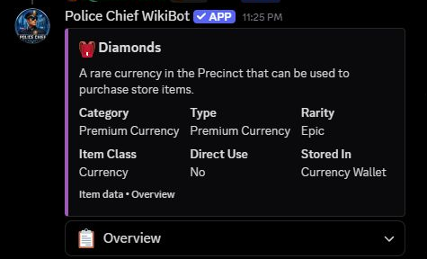
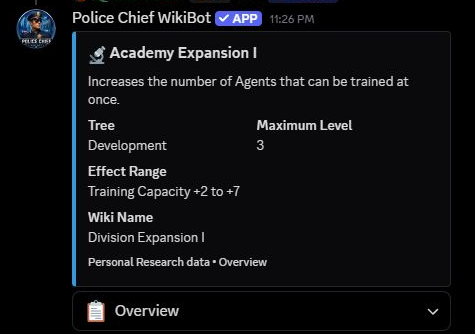

# Police Chief WikiBot — Discovery screenshots

Real Discord screenshots captured on 16 November 2026 in the project's bot-testing channel.

Images are cropped to the bot's own replies. No response text, values or interface elements were reconstructed or altered. Private sidebars and invoking-user details are excluded.

These five images are intended for the Discord App Directory media carousel. Game information and the bot interface may change after capture.

The Mafia Attack artwork shown inside the bot response is credited to EMZ · [NIP] · State 59. Game characters, icons and artwork belong to their respective owners. Police Chief WikiBot is an independent community project, not affiliated with or endorsed by Police Chief or WAL Games.

## Direct image URLs

- [Hero overview and interactive sections](https://raw.githubusercontent.com/NevaDie/PoliceChief-WikiBot-Public/main/assets/discovery/hero-overview.png)
- [Mafia Attack overview featuring EMZ's guide](https://raw.githubusercontent.com/NevaDie/PoliceChief-WikiBot-Public/main/assets/discovery/mafia-attack-guide.png)
- [K9 progression overview](https://raw.githubusercontent.com/NevaDie/PoliceChief-WikiBot-Public/main/assets/discovery/k9-overview.png)
- [Item and currency reference](https://raw.githubusercontent.com/NevaDie/PoliceChief-WikiBot-Public/main/assets/discovery/item-reference.png)
- [Research effects and progression](https://raw.githubusercontent.com/NevaDie/PoliceChief-WikiBot-Public/main/assets/discovery/research-overview.png)

## Preview

### Hero overview and interactive sections

### Mafia Attack overview featuring EMZ's guide

### K9 progression overview

### Item and currency reference

### Research effects and progression

